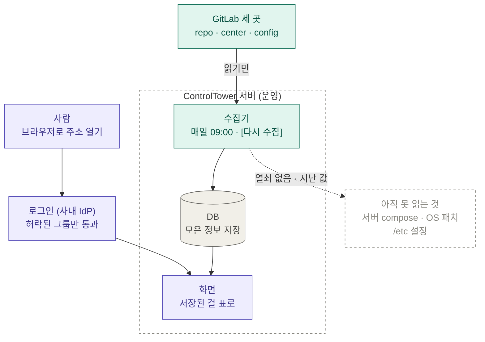

# Control Tower

[](https://github.com/jijungon/ControlTower/actions/workflows/ci.yml)

여러 서버·빌드에 흩어진 **접속키·버전·설정(conf)·업데이트·배포 현황**을 한 곳에서
**수집 → 비교 → 배포**하는 사내 관리 도구. (가칭 Control Tower)

> 전체 기획: [docs/ControlTower-PLAN.md](docs/ControlTower-PLAN.md) · 개발 방법: [docs/DEV.md](docs/DEV.md)

---

## 왜 만드나 (Why)

- 서버가 많고 **15개 게이트웨이(gw) 뒤에 흩어져** 있어, "우리 서버가 몇 대이고 무슨 버전·설정으로 도는지"를 한눈에 보는 곳이 없다.
- 설정이 서버마다 조금씩 어긋나고(드리프트), 누가 언제 바꿨는지 기록이 없다.
- 인증서 만료·밀린 보안 패치·제각각인 배포 방식이 흩어져 방치된다.

→ **중앙 = 기준(정답), 서버 = 실제.** 둘의 차이를 한눈에 보여주고, 기록을 남기며, 안전하게 맞춘다. 이게 이 도구의 뿌리다.

## 무엇을 (What) — 관리 대상 7

| 대상 | 내용 |
|---|---|
| 서버·접속키 인벤토리 | `~/.ssh/config` 기준 서버·gw 목록 + "이 서버는 무슨 키로 들어가나" |
| 빌드 버전 | repo·center(GitLab)의 빌드 node·java·docker 버전 + EOL 매칭 |
| 빌드 설치 항목 | 빌드 시 설치하는 것(Dockerfile `RUN apt/npm`, CI) |
| conf 관리 | 설정 기준본 ↔ 서버 실제본, diff·그룹 배포·롤백 |
| update 관리 | 서버별 밀린 OS 패치(보안 구분) |
| 드리프트 | "기준과 다름"을 전 기능에 관통시키는 배지 |
| CI/CD 배포 현황 | 서비스별 배포 경로·환경 매트릭스·직배포·executor (Phase 5) |

**범위 밖(별도로 뺌):** 파일 공유 + MD 뷰어 → `../MoveFILE/` 별도 프로젝트 · 런타임 설정저장소 중앙화(Valkey/OpenBao/Kong) → 추후 트랙 · PEM(TLS 인증서)·서버 내부 설치 패키지 → 나중.

## 어디서·구조 (Where)

### 지금 이렇게 돌아간다 — 모으는 길 · 보는 길



- **모으는 길(초록)** — **수집기**가 매일 09:00, 그리고 화면 [다시 수집]을 누를 때 GitLab 세 곳을 **읽기만** 해서 DB 에 넣는다(15초 안팎).
  repo = 개발자가 코드를 올리는 곳(빌드 설정 · node 버전) · center = 이미지를 만들고 배포하는 곳(빌드·배포 버전) · config = 서버에서 실행할 설정(Dockerfile · start.sh).
- **보는 길(보라)** — 주소를 열면 **로그인**(사내 IdP)부터, 허락된 그룹만 통과 → **화면**. 화면은 GitLab 을 직접 읽지 않고 **DB 에 모아 둔 것**을 보여 준다. 그래서 화면에 "데이터 기준 ○시 ○분" 이 함께 나온다.
- **DB(회색)** — 두 길이 만나는 곳. 수집기는 넣기만, 화면은 꺼내기만.
- **아직 못 읽는 것(점선)** — 서버 compose · OS 패치 · /etc 는 GitLab 이 아니라 **각 서버 안**에 있어 SSH 로만 읽힌다. ControlTower 서버에는 다른 서버로 들어갈 **키를 두지 않으므로** 지난 값 그대로 — 필요하면 키를 가진 PC 의 러너(아래)로 채우고, 나중에는 IdP 의 단명 SSH 인증서로 읽는다.
- 화면 · API · DB 는 서버 안(127.0.0.1)에만 열리고, 밖에서는 로그인을 거쳐야만 닿는다(→ [docs/DEPLOY.md](docs/DEPLOY.md) 의 ⚠ BIND_ADDR).
- 코드 반영: GitHub `main` → 서버가 새 코드를 받아 다시 띄움.

### 서버 안의 정보를 읽을 때 — 러너(키를 가진 PC)

```
                       ssh                nested ssh
  ┌──────────────┐   (local 키)  ┌─────────┐ (gw 보유 키) ┌──────────┐
  │ local PC(러너) │ ───────────▶ │ GW(점프) │ ──────────▶ │ 대상 서버  │
  └──────┬───────┘              └─────────┘             └──────────┘
         │ 결과만 올림
  ┌──────▼───────┐
  │ 중앙(CT 서버)  │  화면·API·DB·수집기 (Docker) · 키 0
  └──────────────┘
```

- **중앙(ControlTower 서버)**: 화면 + API + DB + 수집기. Docker 컨테이너. **SSH 키를 저장하지 않음**. 사내 IdP 로그인 뒤.
- **러너(local)**: 키를 가진 PC 에서 실행. gw를 nested ssh로 통과해 수집·배포, 결과만 중앙에 업로드.
- **코드**: GitHub [`jijungon/ControlTower`](https://github.com/jijungon/ControlTower). 주 개발은 로컬(SQLite, `make dev`).

## 어떻게 (How)

- **agentless** — 대상 서버·gw에 설치물 없음. 이미 있는 SSH만 사용.
- **동기화** — Pull(수집): 주기적으로 버전·conf 수집 → 기준본과 diff → 배지 / Push(적용): dry-run diff → 승인 → 서버 백업 → 교체 → 검증 → reload, 실패 시 자동 롤백.
- **GitOps** — 설정 기준본은 Git에. 이력·롤백·감사 로그가 공짜.
- **스택** — 중앙 FastAPI + React + SQLite(→PostgreSQL) / 러너 Python(asyncssh). 설정은 `.env` 주입(pydantic-settings·dotenv).
- **얇은 코어** — Redis/Consul/Kong 등 무거운 인프라는 내부에 안 들임(라이선스·SPOF 부담 회피). 대신 나중에 "관리 대상"으로 품는다.
- **개발/테스트** — 로컬 우선(SQLite, `make dev`/`make test`, Docker 불필요). 기능 단위 worktree + PR. CI는 **PR마다 빠른 검사(pytest·vitest·gitleaks), merge queue에서 무거운 검사(e2e·image·deps-audit)** — FileSharer 방식.

## IdP-옵셔널 — 나중에 인증 플랫폼에 꽂는 준비

ControlTower는 **혼자서도 그대로 돌고**, 나중에 사내 IdP/Secrets 플랫폼(Authentik + OpenBao SSH CA)이
서면 **환경변수 스위치 3개**만 켜서 붙는다. 코드 수정 없음. (중앙이 SSH 키를 park 하지 않는 원칙의 완성형)

| 어댑터 | 스위치 | 기본(지금) | 플랫폼 모드 |
|---|---|---|---|
| 접속(러너) | `CT_SSH_MODE` | `key` — `~/.ssh/config` 상주 키 | `cert` — OpenBao 단명 SSH 인증서 |
| 로그인(웹) | `CT_AUTH_MODE` | `none` — 로그인 없음 | `oidc` — Authentik OIDC (`GET /api/me`) · `proxy` — 앞단 Authentik 이 붙인 서명된 토큰 |
| 비밀(중앙) | `CT_SECRET_MODE` | `env` — `.env`/환경변수 | `vault` — OpenBao KV |

- 각 모드는 **미설정·실패 시 기본으로 폴백**한다(안전). 기본값만 쓰면 예전과 100% 동일하게 동작.
- `CT_AUTH_MODE=proxy` — 앞단 Authentik(프록시)이 요청마다 붙이는 `X-authentik-jwt` 의 **서명을 검사**해서 그 안의 이메일 · 그룹을 쓴다. 서버 탭 '누가 · 어디로' 가 이 그룹으로 거른다(server-admin=전부, developer=dev · stg).
  글자 헤더(`X-authentik-email` · `-groups`)는 믿지 않는다 — 누가 흉내 내 보내도 서명이 안 맞는다. 토큰이 없거나 검사에 떨어지면 '누군지 모름' 으로 막는다.
  필요한 값: `CT_OIDC_ISSUER`(필수 — 같은 키로 서명하는 다른 앱 토큰을 거름) · `CT_OIDC_AUDIENCE`(넣으면 검사) · 서명 방식마다 키 하나:
  - **HS256** — Authentik 프록시 provider 는 저장할 때마다 서명 키를 지워 설계상 HS256(공유 비밀 = provider 의 client_secret)이다. 그 비밀을 서버 안 파일로 두고 `CT_OIDC_HS256_SECRET_FILE` 로 가리킨다(파일이 없거나 비면 통과시키지 않고 `/api/me` 에 까닭).
  - **RS256** — `CT_OIDC_JWKS_URL`(provider 의 jwks).
  - 토큰의 alg 마다 그 키 · 그 방식 하나만 쓴다(공개키를 HMAC 비밀로 쓰는 혼동을 막음). 그 밖(none 등)은 거부. 만료 필수.
  켜는 순서: 금고 연결은 끈 채(`CT_INVENTORY_MODE` 없음 — 화면은 그대로) `CT_AUTH_MODE=proxy` 만 켜고, 로그인해서 `/api/me` 를 연다 → `proxy` 칸에 토큰이 왔나 · 통과했나 · 떨어진 까닭 · 토큰에 적힌 `aud` · 클레임 이름(`groups` 가 있나)이 보인다. `aud` 를 `CT_OIDC_AUDIENCE` 에 넣고 통과를 본 뒤 금고 연결을 켠다.
- 플랫폼 자체(Authentik/OpenBao)는 **별도 프로젝트** — 설계·계획은 로컬 전용 `~/Downloads/parameta-idp-secrets/`.

### 운영에서 OpenBao에 붙일 때 (TLS·mTLS)

운영 OpenBao는 HTTPS(사내 CA 발급)에 LB가 mTLS를 요구할 수 있다. 주소가 `https://` 일 때만 적용되며,
`http://`(PoC·개발)에는 **아무 영향이 없다.**

| | 러너(`CT_SSH_MODE=cert`) | 중앙(`CT_SECRET_MODE=vault`) |
|---|---|---|
| 사내 CA 번들(PEM) | `CT_BAO_CACERT` | `CT_VAULT_CACERT` |
| 클라이언트 인증서 | `CT_BAO_CLIENT_CERT` | `CT_VAULT_CLIENT_CERT` |
| 클라이언트 개인키 | `CT_BAO_CLIENT_KEY` | `CT_VAULT_CLIENT_KEY` |
| **실패 시 중단(운영 필수)** | `CT_SSH_CERT_REQUIRED=1` | `CT_SECRET_REQUIRED=1` |

> ⚠️ **`*_REQUIRED`를 운영에서 반드시 켠다.** 폴백은 개발 편의를 위한 것이라, 켜지 않으면
> TLS·토큰 문제로 OpenBao 연동이 깨져도 러너는 **상주 키로 계속 접속**하고 중앙은
> **공개된 기본값(`dev-secret-change-me`)으로 기동**한다 — 둘 다 조용히 일어난다.
> 켜지 않아도 실패는 이제 `stderr` 경고로 남는다.

> ⚠️ 사내망에 **TLS 검사 프록시**가 있으면 중간에서 인증서를 갈아끼우기 때문에 mTLS가 깨진다.
> OpenBao 엔드포인트는 프록시 **검사 예외(bypass)** 목록에 넣어야 한다.

## 언제 (When) — 로드맵

| Phase | 내용 | 상태 |
|---|---|---|
| 0. 기반 | 서버 인벤토리·`~/.ssh/config` 임포트·연결 테스트 | ← **다음** |
| 1. 수집(read-only) | 접속키·빌드 버전·conf 수집 + 통합 대시보드 = **MVP** | |
| 2. 배포·동기화 | Git 기준본·드리프트·push 파이프라인·감사 로그 | |
| ~~3. 파일·MD~~ | 별도 프로젝트로 분리(`../MoveFILE/`) | 분리됨 |
| 4. 알림·운영 | 만료/드리프트 알림·업데이트 적용·EOL | |
| 5. CI/CD 현황 | 두 GitLab 파이프라인 파싱·배포 현황 대시보드 | |

**현재 상태:** 7개 탭 전부 실데이터로 연결됨 — 서버·접속키(그룹·태그·필터), conf(드리프트 + 계획→승인→적용→롤백), 업데이트(apt), 버전(빌드서버 툴체인 + GitLab 선언본), CI/CD 현황, 작업이력(감사), 대시보드. 러너 수집기(import/test/conf/updates/versions/versions-repo/cicd) + `all`(주기 수집) + `apply`(안전 배포). **접속·로그인·비밀 3개 어댑터로 IdP-옵셔널 준비 완료**(위 § 참조). CI 6잡(backend·frontend·gitleaks·deps-audit·image·e2e) — PR은 빠르게 / merge queue는 꼼꼼. GitLab 실연결만 인스턴스 준비 대기(코드 완비).

## 빠른 시작 (로컬)

```bash
make setup     # venv + 의존성 + .env (최초 1회)
make dev       # 중앙 API 로컬 실행 (SQLite, hot-reload) → http://127.0.0.1:8000/health (version·build 포함)
make test      # 전체 테스트
```

전체 스택을 컨테이너로: `docker compose up -d --build` → 웹 http://127.0.0.1:8090 · API http://127.0.0.1:8000. 로컬에서 이게 곧 **상시 운영(=prod)**이다. `make dev` 는 코딩 중 hot-reload용. 개발 흐름 [docs/DEV.md](docs/DEV.md) · **사내 VM 배포 [docs/DEPLOY.md](docs/DEPLOY.md)**.

주기 수집(모든 수집기 1회): `make collect` — cron 에 등록하면 데이터가 계속 최신으로 유지된다.
상주 실행: `python -m runner.cli all --loop --interval 300`.

## GitLab 연동 켜기

CI/CD 파이프라인 상태와 repo 선언본 버전(node/nest/java)은 GitLab 에서 읽는다. GitLab 이 준비되면:

1. **러너 `.env`** 에 토큰 설정 (러너 로컬에만 — 중앙엔 저장 안 함):
   ```
   CT_GITLAB_URL=https://gitlab.example.com
   CT_GITLAB_TOKEN=glpat-xxxxxxxx    # read_api 스코프면 충분
   ```
2. **웹에서 대상 등록**:
   - CI/CD 탭 → *서비스 추가* (서비스 이름 + `group/repo`)
   - 버전·빌드 탭 → *GitLab 선언본 대상 추가*
3. **러너 실행**: `python -m runner.cli cicd` (파이프라인) · `versions-repo` (선언본).
   `make collect` / cron 도 GitLab 설정 시 이 둘을 포함한다.

> GitLab 이 아직이면 이 두 기능만 비어 있고, 나머지(서버·conf·업데이트·툴체인·작업이력)는 그대로 동작한다. 토큰은 **러너 로컬에만** 두며 중앙 DB엔 결과 상태만 저장된다.

### 서비스 비교표 · config (빌드·배포 탭 / config 탭)

- **빌드·배포 탭** — CI 가 **어떻게 빌드·배포하나**(CI 파일 기준). 그룹(프로젝트 묶음) → 서비스 → 타입(web·was)으로 묶어 **환경별 배포(파일 복사 · repo / 파일 복사 · center / 이미지 / 빌드만) · executor**를 나란히 비교. 표 위 "표 읽는 법"에 각 칸의 뜻.
- **config 탭** — 이미지가 **무엇으로, 어떻게 실행되나**(config repo + 서버 compose 기준). 폴더(서비스/타입)마다 **런타임·베이스 이미지(같은 종류 중 최신이 아니면 빨간 칸, 런타임 필터) · 실행 명령 위치(Dockerfile CMD / start.sh) · start.sh 상태(구형/잔재/완료) · start.sh 형태**(서버 compose 기준: shell = start.sh 마운트 / compose = `command:` 직접 / Dockerfile = 이미지 CMD) 표시.

1. `cp runner/shape-targets.example.yml shape-targets.yml` 후 읽을 파일을 적는다 (커밋 안 됨).
   - GitLab: `{gitlab: repo|center, project, path}` — center 는 별도 인스턴스라 `CT_GITLAB_CENTER_URL/TOKEN`
   - 로컬 사본: `{file: 경로}` · 서버의 실제 파일(compose 등): `{ssh: 호스트별칭, path}`
   - `config:` 에 config repo 를 적으면 폴더를 자동으로 훑고, 서비스는 `config_dir:` 로 연결. 서비스 묶음마다 config repo 가 따로면 `config:` 를 **목록**으로(`- project: …` 한 덩어리 추가, `group:` 은 연결 안 된 폴더의 그룹). Dockerfile·start.sh 없는 폴더는 건너뜀
2. `python -m runner.cli shape` (`make collect` 도 대상 파일이 있으면 포함)
3. 서버 compose 를 실서버에서 읽기(선택): center CI 의 `DEPLOY_<환경>[_<타입>]_SERVERS` 와 `APP_DIR` 로 서버·폴더를 찾아
   - `python -m runner.cli shape --ssh-plan` — 어느 서버의 어떤 파일을 읽을지 **목록만** (접속 안 함)
   - `python -m runner.cli shape --ssh` — 그 목록대로 SSH 로 읽음(읽기만). 서버가 `~/.ssh/config` 에 직접 있거나,
     대상 파일의 `gateways:`(환경 → gw 별칭)를 거쳐 들어감(PC → gw → 서버, 안쪽은 gw 의 키·설정)
     - gw 의 `~/.ssh/config` 에 이름으로 등록된 서버는 그 이름으로 접속(gw 가 맞춰 둔 계정·키·지문 그대로)
     - 안쪽 서버가 gw 의 root 계정에만 등록돼 있으면 `gateway_sudo: [gw 별칭]` — `sudo -n` 으로 root 설정을 씀(읽기만)
     - CI 에 배포 단계가 없는 서비스는 `compose: {prod: {ssh: <gw 의 이름>, via: <gw 별칭>, path: …}}` 로 직접 적기
   - 이미지 하나를 역할별로 나눠 띄우는 서비스: `type`(표에 보일 이름) · `tag_type`(태그·폴더 타입) · `deploy_role`(`DEPLOY_<환경>_<역할>_SERVERS`)
     — config 탭은 역할마다 한 줄(옆에 실제 폴더)
   - config 탭 (서버) 칸 옆에 출처 표시: 서버 · 자동 · gw · 사본 · 옛 사본 (좁은 화면에선 마우스로)

4. **GitLab 에서 읽기(기본)**: 대상 파일의 서비스 `repo:`/`center:`, `config:` 의 `project:` 에 적힌 GitLab 프로젝트를 **무조건 API 로** 읽는다.
   - 토큰: runner 쪽 `.env` 의 `CT_GITLAB_URL`·`CT_GITLAB_TOKEN`(repo), `CT_GITLAB_CENTER_URL`·`CT_GITLAB_CENTER_TOKEN`(center) — 읽기 전용 `read_api`, 그룹 토큰 권장. 없으면 빈 표를 올리지 않고 멈춤
   - API 로 읽은 쪽은 러너마다 최근 job 로그 맨 윗줄(`Preparing the "shell" executor`)로 **executor 를 확정**(같은 러너는 한 번만 읽음, 근거 = job 번호). image: 없이 도는 job 은 로그에 찍힌 러너 기본 이미지도 보여줌
   - 로컬 사본(`repo_ci`/`center_ci`/`file`)은 **고를 때만**: `python -m runner.cli shape --source local`. 프로젝트 이름이 없는 서비스만 로컬 사본을 읽고, 실행할 때 알려줌
   - 실행 첫 줄 `읽는 곳:` 에 어디서 읽는지 표시. 토큰은 runner 에만 있고 중앙엔 안 올라감(나중엔 OpenBao 에서 실행할 때만 받기)

> 읽기 전용. 읽은 파일 원문은 중앙에 올리지 않고 결과 칸만 올린다. CI 변수는 **값 없이** 개수 + 해시만 보낸다(화면엔 안 보임). executor 는 **job 마다** 정한다(job 이름: 방식, 가장 많은 쪽은 '나머지 N개'). CI 파일만으로는 확정할 수 없어 대상 파일의 `runners:` 표(태그→shell/docker)에 있으면 확정, 없으면 `image:` 유무로 `(추정)` — 확정은 job 로그 맨 윗줄 `Preparing the "…" executor`. (GitLab 토큰이 있으면 이 로그를 API 로 읽어 자동 확정 — 4번)

### 화면에서 [다시 수집] — 수집기(agent)

빌드·배포 · config 탭의 **[다시 수집]** 버튼은 GitLab 을 다시 읽어 오라는 **요청**을 남긴다(↻ 는 이미 모은 값을 화면에 다시 불러오기만).
중앙은 키·토큰이 없어 직접 모으지 않는다 — 요청은 **수집기**가 가져가 처리한다.

- 수집기: `python -m runner.cli agent` (`make agent`) — 5초마다 요청 확인, 있으면 `shape` 를 **GitLab 만** 다시 읽어 올림
  - **자동**: 매일 `CT_COLLECT_DAILY_AT`(예 `09:00`, 시간대 `CT_COLLECT_TZ` 기본 Asia/Seoul)에 한 번 — 그날 이미 모았으면 건너뛰고, 그 시각에 꺼져 있었으면 켜질 때 한 번. **수동**: 화면 [다시 수집]
  - 서버 compose 는 SSH 로 안 읽고 **지난 수집 값**을 이어 씀(화면 출처에 `· 지난 값`). 키가 있는 PC 에서 `--ssh` 면 compose 도
- 서버: `docker compose up -d` 의 `collector` 서비스가 같은 일 — env 파일을 나눔: 중앙(api·db)은 `.env`, 수집기는 `collector.env`(GitLab 읽기 토큰, `collector.env.example` 복사) + `shape-targets.yml`(읽기 전용으로 붙임)
- 회사망이 HTTPS 를 중간에서 다시 서명하면(Cloudflare Zero Trust 등) 컨테이너가 `CERTIFICATE_VERIFY_FAILED` 로 GitLab 에 못 붙음 → `docker-compose.override.example.yml` 을 복사해 CA 묶음을 붙이고 `collector.env` 에 `SSL_CERT_FILE=/certs/ca-bundle.pem`
- 처음 한 번은 키가 있는 PC 에서 `python -m runner.cli shape --ssh` 로 서버 compose 값까지 채움 — 이후 버튼(GitLab 만)은 그 값을 이어 씀
- 화면 상태: 수집기가 꺼져 있으면 버튼도 꺼짐(10초마다 확인해 켜지면 켜짐) · 요청됨 → 수집 중 → 완료(표 새로 불러옴) / 실패(이유). 15분 넘게 안 끝나거나 10분 동안 아무도 안 가져가면 실패로 닫음
- 빌드·배포 · config 는 ↻ 대신 이 버튼(끝나면 표를 새로 불러옴) — 데이터 기준 시각도 버튼 옆 한 곳에만
- 속도: GitLab 호출을 미리 동시에(8개씩) 읽고, 같은 호출은 수집 한 번에 한 번만(같은 프로젝트의 job 목록 등), 버전 파일은 폴더 목록을 보고 있는 것만, 연결은 재사용 — 한 번에 55초 → 15초 안팎
- API: `POST /api/collect/requests`(버튼) · `GET /api/collect/status` · `POST /api/collect/claim`·`/requests/{id}/finish`(수집기, 러너 토큰)

### 화면 맨 위 — 서버 상태(정상 · 경보 · 모름)

서버가 스스로 적는 상태 파일(`status.json`, 1분마다)을 수집기가 5초마다 읽어 올리고, 모든 탭 맨 위에 한 줄로 보여 준다.
규칙은 하나 — **못 본 것을 정상으로 보이지 않는다.**

| 한 줄 | 언제 |
|---|---|
| 초록 · 정상 | `ok` 가 참이고 `problems` · `unread` 가 둘 다 비었을 때만 |
| 빨강 · 경보 | `ok=false` 이거나 문제 · 못 본 것이 하나라도 있음(둘 다 보여 줌) · 파일이 갱신 주기 × `CT_HOST_STATUS_STALE_FACTOR`(기본 5) 넘게 안 바뀜 |
| 회색 · 모름 | 파일 없음 · JSON 깨짐 · 권한 없음 · 수집기가 한동안 안 올림 — 마지막 기록 시각도 같이 |

- 수집기: `CT_IDP_STATUS_FILE`(기본 `/idp-status/status.json`, 빈 값이면 끔) · 바뀌면 바로, 아니어도 1분마다 올림 · 올리기 실패가 [다시 수집] 을 막지 않음
- 아무도 올린 적 없으면(기능을 안 씀) 화면에 아무것도 안 뜸 · API: `POST /api/host-status`(수집기, 러너 토큰) · `GET /api/host-status`

### 접속 기록 탭 — 누가 · 언제 인증서를 받았고, 그걸로 어느 gw 에 들어갔나 (운영자만)

사내 IdP 서버가 금고 감사 기록을 1분마다 요약 파일(`access.jsonl`, 최근 14일)로 적고, 수집기가 읽어 올린다. 서버 상태 파일과 같은 길.
**인증서(도장)를 받은 기록이지 서버에 실제로 들어간 기록이 아니다** — 인증서는 30분~1시간 쓸 수 있고 여러 번 쓰거나 안 쓸 수도 있다.
실제로 어느 gw 에 들어갔는지는 2단계 파일(`gw-logins.jsonl`)이 알려 준다 — 아래.

| 화면 | 언제 |
|---|---|
| 표 | 읽었고 기록이 새것 — 최신순, 사람 줄만(기계 · 시험/관리 토큰은 접어 둠), 기간 · 환경 · 사람 거르기. 0건이면 "최근 N일 접속 없음" |
| 못 봄 · 멈춤 | 요약 파일 없음(IdP 반영 전 포함) · 못 읽음 · IdP 가 금고 기록을 못 읽음 · 읽은 파일 0개 · 읽은 줄 0줄 · 기록이 주기 × `CT_HOST_STATUS_STALE_FACTOR` 넘게 그대로 · 수집기가 한동안 안 올림 — 표 대신 까닭 |
| 연결 전 | 수집기가 올린 적 없음 |

- 누가 보나: 운영자(server-admin)만. 개발자 · viewer 는 403. 그룹을 모르면(`CT_AUTH_MODE=none`) 막음 — 로컬 미리보기(`CT_ACCESS_LOCAL_PREVIEW=1`)만 열림
- 수집기: `CT_IDP_ACCESS_FILE`(기본 `/idp-status/access.jsonl`, 빈 값이면 끔) · 내용이 바뀌면 바로, 아니어도 1분마다 올림 · 중앙은 올 때마다 통째로 바꿈(쌓지 않음 — 보존은 IdP 쪽 원본)
- API: `POST /api/access-log`(수집기, 러너 토큰) · `GET /api/access-log`(운영자)

**2단계 — 들어간 gw · 시각.** gw 가 5분마다 자기 sshd 기록에서 '인증서로 들어온 줄' 만 금고에 보고하고, IdP 서버가 모아
`gw-logins.jsonl`(최근 14일, gw 접속 한 번에 한 줄 + gw 마다 마지막 보고)로 적는다. 화면은 발급 기록 줄마다 그 인증서 번호로
들어간 gw · 시각 · 계정을 붙인다(여러 번이면 횟수). 이어 붙일 발급 기록이 없는 접속은 따로 "발급 기록 없음(14일 넘음 등)".
**보고 안 하는 gw 가 있으면 '거기엔 아무도 안 들어갔다' 고 말할 수 없다** → gw 마다 보고 상태를 같이 보인다.

| gw 보고 상태 | 언제 |
|---|---|
| 보고 중 | 마지막 보고가 보고 주기(보통 5분) × 3 안 |
| 보고 끊김 | 마지막 보고가 주기 × 3(15분)보다 오래 |
| 못 봄 | gw 가 자기 sshd 기록을 못 읽음(read_ok=false) · 마지막 보고 시각을 못 읽음 |
| 보고 안 함 | 금고 목록(서버 탭)에 있는 gw 인데 보고가 없음 — 이름 규칙 `gw-<서비스>-<환경>` 으로 견줌. 금고 목록이 꺼졌거나 못 읽으면 "견줄 수 없음" |

- 파일이 없거나(IdP 반영 전) 멈췄으면 발급 기록과 같은 규칙으로 '못 봄' — 들어간 gw 칸도 '못 봄'(빈 칸을 '안 들어감' 으로 안 보임)
- 수집기: `CT_IDP_GW_LOGINS_FILE`(기본 `/idp-status/gw-logins.jsonl`, 빈 값이면 끔) · 중앙은 같은 `access_log` 표의 `idp-gw` 줄(칸 3개 추가, 마이그레이션 `b8f2d6a4c1e9`)
- API: `POST /api/access-log/gw-logins`(수집기) · `GET /api/access-log/gw-logins`(운영자 — 발급 기록과 같은 선)

### 서버 탭 '목록 고치기' — 운영자가 gw · 서버를 금고에 고침 (기본 끔)

서버 탭 '누가 · 어디로' 의 목록(금고 `inventory/<환경>/<서비스>`)은 원래 gw 의 `idp-login service add · server add · user add` 로만 적는다.
스위치를 켜면 운영자가 화면에서 **gw 주소 · 포트와 서버(이름 · 주소)** 를 고칠 수 있다.

- 켜기: 서버 `.env` 에 `CT_INVENTORY_EDIT=1`(compose 가 api 에 넘김 — compose 의 `environment` 가 `env_file` 보다 앞서므로 env_file 에 넣으면 안 먹음)
  + 금고 `ct-inventory` 정책에 `inventory/data/*` 의 `update` 를 더해야 저장된다. 정책이 없으면 금고가 거절하고 화면에 그 까닭(`permission denied`)을 그대로 보인다.
- 누가: 운영자(server-admin)만. 개발자는 '서버 탭만' 문지기가 403, viewer 는 403, 그룹을 모르면 403(로컬 미리보기만 열림).
- 못 고치는 것: **사람(users)** — `idp-login user add` 가 gw 에 OS 계정도 만들어서 목록만 바꾸면 어긋난다. 새 서비스 · 서비스 지우기도 gw 에서.
- 안전하게: 열 때 금고에서 새로 읽어 판 번호(v)를 쥐고 → [바뀐 것 보기](금고 지금 판과 비교) → [저장] = 읽은 통째에서 gw · servers 만 바꿔 `cas=그 판` 으로 씀.
  그 사이 idp-login 이 먼저 고쳤으면 금고가 거절 → "다시 불러온 뒤 고쳐 주세요". 모르는 칸 · users 는 그대로. 답을 못 받으면 "저장됐는지 모름".
- 누가 고쳤나: 작업이력(`inventory.edit`, 이메일 · `v7 → v8` · 바뀐 종류 — 주소는 안 적음). 금고 안에는 안 적는다. 시각은 금고가 판마다 적는 `created_time`.
- 금고에 하는 일: `GET inventory/data/<환경>/<서비스>` · `POST inventory/data/<환경>/<서비스>`(`options.cas`) 둘뿐 — create · delete · metadata 쓰기 없음.
- API: `GET /api/inventory/<환경>/<서비스>` · `POST …/preview` · `PUT …` (`routers/inventory_edit.py`)

### 탭별 출처 — 고칠 때 어디를 보면 되나

기준: **방식(어떻게)은 빌드·배포, 버전(무엇으로)은 config, 서버에 깔린 것은 서버 탭.** 화면의 표마다 같은 "출처" 줄이 붙어 있다.

| 탭 · 표 | 무엇을 | 어디서 읽나 | 수집(러너) | API · 화면 코드 |
|---|---|---|---|---|
| 대시보드 | 아래 수집 결과 요약 | (각 탭 데이터) | — | `Dashboard.tsx` |
| 서버 · 서버 목록 | 서버·접속 키·접속 확인 | 내 PC `~/.ssh/config` · SSH 접속 | `import` · `test` · `probe` | `/api/servers` · `Servers.tsx` |
| 서버 · 깔린 도구 칸 | 서버마다 node/java/docker 버전 | 서버마다 SSH 로 `--version` | `versions` | `/api/versions` · `Servers.tsx` |
| 서버 · 서버 설정 파일 (/etc) | 서버마다 같아야 하는 파일 비교·적용 | 서버마다 SSH 로 등록한 파일 | `conf` · `apply` | `/api/conf` · `Conf.tsx` |
| 빌드·배포 · 서비스 비교 | 환경별 배포 방식 · executor | repo·center `.gitlab-ci.yml` (+ 서버 compose 로 확인) | `shape` (대상 `shape-targets.yml`) | `/api/cicd/shape` · `CicdCompare.tsx` |
| config · config 폴더 | 코드에 적힌 버전 · 런타임/베이스 이미지 · 실행 명령 위치 · start.sh 상태·형태 | center config repo(Dockerfile·start.sh) · repo 코드(`.nvmrc`·`package.json`·`pom.xml`) · 서버 compose | `shape` (대상 `shape-targets.yml`) | `/api/cicd/config` · `ConfigRepo.tsx` |
| OS 패치·작업이력 · OS 패치 | 서버마다 안 깔린 패치 | 서버마다 SSH 로 apt(→yum/dnf) | `updates` | `/api/updates` · `Updates.tsx` |
| OS 패치·작업이력 · 작업이력 | ControlTower 가 한 모든 일 | 중앙 API 가 기록 | — | `/api/audit` · `Jobs.tsx` |

- 수집은 `python -m runner.cli <명령>`, 한 번에 다 돌리려면 `all` (`make collect`).
- 판독 규칙은 `runner/cishape.py`(CI·Dockerfile·compose·코드 버전), 버전 비교(빨간 칸)는 `central/web/src/vercmp.tsx`.
- 표마다 ↻ 는 **화면 새로고침**(중앙에 저장된 값을 다시 읽음)이다. 서버·GitLab 을 다시 읽는 건 러너 몫.
- 쓰지 않게 된 것: 파이프라인 상태(`runner cicd`, `/api/cicd`·`/api/cicd/targets`)와 GitLab 선언본 대상(`runner versions-repo`, `/api/versions/repo-*`)은 화면에서 뺐다. 코드에 적힌 버전은 이제 `shape` 가 config 탭으로 모은다.

## 저장소 구조

```
ControlTower/
├── docker-compose.yml · .env.example · Makefile
├── central/
│   ├── api/          FastAPI 백엔드 (Dockerfile, app/, tests/)
│   └── web/          React 프론트 (placeholder → 추후)
├── db/               schema.sql (데이터 모델 정본)
├── runner/           러너 CLI (로컬 네이티브, tests/)
└── docs/             PLAN · DEV · 빌드환경 체크리스트 · CICD 현황 · 설정저장소(추후 트랙)
```

## 문서

- [docs/ControlTower-PLAN.md](docs/ControlTower-PLAN.md) — 전체 기획(기능·아키텍처·로드맵·열린 질문)
- [docs/DEV.md](docs/DEV.md) — 로컬 개발 · worktree · 테스트 · PR
- [docs/supercycl-CICD-현황.md](docs/supercycl-CICD-현황.md) — Phase 5 근거 조사
- [docs/ControlTower-빌드환경-체크리스트.md](docs/ControlTower-빌드환경-체크리스트.md) — 열린 질문 5 확인용
- [docs/관련과제-설정정책중앙화.md](docs/관련과제-설정정책중앙화.md) — 추후 트랙(런타임 설정저장소)
